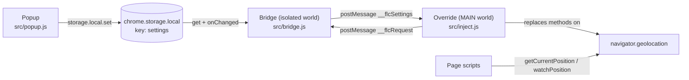

# Fake Location

A small Manifest V3 extension for Chrome and Brave that overrides `navigator.geolocation` on every page with coordinates you choose. No build step, no dependencies, no network requests.

> **Scope:** this changes what websites read from the browser Geolocation API, and nothing else. It does not change your IP address, your account country, WebRTC, or any network-based location signal. See [Limitations](#limitations).

## Features

- Overrides `getCurrentPosition`, `watchPosition` and `clearWatch` in every page and every frame.
- Active before page scripts run (`document_start`, `MAIN` world), so pages cannot grab the native API first.
- Set latitude, longitude and accuracy in a popup. Input is validated before it is saved.
- Changes reach tabs that are already open through `chrome.storage.onChanged`, no reload needed.
- On/off switch. When off, requests go to the real browser location, including the normal permission prompt.
- A button that prefills the form with your real position.
- Settings live only in `chrome.storage.local`. Nothing leaves your machine.

## Install (unpacked)

The extension is not on the Chrome Web Store. Load it from source:

1. Clone or download this repository.
2. Open `chrome://extensions` (Brave: `brave://extensions`).
3. Turn on **Developer mode**.
4. Click **Load unpacked** and select the repository folder (the one containing `manifest.json`).
5. Reload tabs that were already open, so the content scripts get injected.

```sh
git clone https://github.com/eminogrande/fake-location-ip-chrome.git
```

Pages opened from `file://` additionally need **Allow access to file URLs** in the extension's details page.

## Usage

Click the toolbar icon to open the popup. The popup interface is currently in German.

| Popup field | Range | Notes |
| --- | --- | --- |
| Fake-Standort aktiv | on / off | Off passes every call to the real API. |
| Breitengrad (latitude) | -90 to 90 | Decimal degrees. |
| Längengrad (longitude) | -180 to 180 | Decimal degrees. |
| Genauigkeit (accuracy) | 0 or more, finite | Meters. |

Click **Speichern** to save. Invalid fields are marked and nothing is written until all of them are valid. **Zurücksetzen** restores the defaults. **Echten Standort übernehmen** fills the form with your real position (you still have to save).

Defaults: enabled, Berlin (`52.52`, `13.405`), accuracy `50` m.

To find coordinates, right-click a spot in any map application and copy the decimal latitude and longitude. For example, Tokyo is roughly `35.6762`, `139.6503`.

## How it works

Extension content scripts run in an isolated world by default. They can use `chrome.*` APIs, but changes they make to `navigator.geolocation` are invisible to the page. Page-visible changes have to be made from the `MAIN` world, where `chrome.*` is not available. The extension therefore uses one script in each world and connects them with `window.postMessage`.



1. **MAIN-world override at `document_start`.** `manifest.json` registers `src/lib/validate.js`, `src/lib/position.js` and `src/inject.js` with `"world": "MAIN"`, `"run_at": "document_start"`, `"all_frames": true` and `<all_urls>` matches. `inject.js` first binds the native methods, then defines its own `getCurrentPosition`, `watchPosition` and `clearWatch` on `navigator.geolocation`.
2. **Isolated bridge.** `src/bridge.js` runs in the default isolated world, also at `document_start`. It reads `settings` from `chrome.storage.local` and forwards the stored object to the page with `postMessage`. It only reacts to messages from its own window.
3. **Startup handshake.** The two scripts can start in either order, so the override asks for settings every 50 ms (up to 40 tries) until the first answer arrives. Until then, calls go to the native API.
4. **Validation.** The override passes the received object through `normalizeSettings` (`src/lib/validate.js`). If any field is invalid, spoofing stays off and calls go to the native API.
5. **Live updates.** The bridge listens to `chrome.storage.onChanged` (area `local`) and posts the new value to the page, so open tabs follow the popup immediately.

### Supported methods

| Method | Spoofing on | Spoofing off |
| --- | --- | --- |
| `getCurrentPosition(success, error, options)` | Calls `success` asynchronously with the configured position. | Delegates to the native method. |
| `watchPosition(success, error, options)` | Returns its own watch ID, delivers a position immediately, then every 10 s. | Starts a native watch. |
| `clearWatch(id)` | Stops the own watch. Unknown IDs go to the native `clearWatch`. | Same. |

The position has `coords.latitude`, `coords.longitude`, `coords.accuracy` and `timestamp`. `altitude`, `altitudeAccuracy`, `heading` and `speed` are `null`. The position and `coords` both have a `toJSON()` method.

### Dynamic updates

- Changing the coordinates while spoofing is on updates running watches right away.
- Turning spoofing off ends the spoofed watch and starts a native one for the same callbacks.
- Turning spoofing on takes over watches that were already running natively.

### Privacy and permissions

- Permissions: `storage` and `geolocation`. No host permissions and no background service worker.
- The only stored data is the `settings` object (enabled flag, latitude, longitude, accuracy) in `chrome.storage.local`.
- The code makes no network requests. It is plain JavaScript in `src/`.
- The `geolocation` permission is used by the popup's "Echten Standort übernehmen" button, which asks the browser for your real position.

## Limitations

- **Only `navigator.geolocation` is changed.** Your IP address, account country, WebRTC and any network-based location stay real.
- `navigator.permissions.query({ name: 'geolocation' })` still reports the real permission state.
- **No address autocomplete or geocoding.** You enter coordinates, not street addresses.
- **Not on the Chrome Web Store.** Install it unpacked, as described above.
- Tabs that were open before installation are not affected until reloaded.
- The popup text is German only.

### Example: Spotify Family

Setting a fake location for a Spotify Family address check showed the limits of this approach. Changing the browser geolocation alone was not sufficient. The account country, the IP address and the family address all had to match the same place. If a service looks at more than browser geolocation, this extension covers only that one signal.

## Testing

Requires Node.js (CI uses version 22). There are no packages to install.

```sh
npm test    # runs: node --test test/*.test.js
```

The suite has 24 tests in four files:

| File | Tests | Covers |
| --- | --- | --- |
| `test/validate.test.js` | 6 | Range checks, defaults, garbage input. |
| `test/position.test.js` | 4 | Position and coordinates shape, `toJSON`, timestamps. |
| `test/inject.test.js` | 8 | The real override in a `vm` context with fake browser APIs: pass-through, spoofing, watches, mode switching. |
| `test/bridge.test.js` | 6 | Storage load, `onChanged` forwarding, window check, `lastError`, single install. |

Two manual browser pages are included. Open `test/smoke.html` from a local server (for example `npx serve .`) with the extension loaded and use the buttons. `test/e2e.html` needs no clicks and writes its results to `data-*` attributes on `<body>` (`data-early`, `data-lat`, `data-hits-after-clear`), so a CDP script can read them.

GitHub Actions runs `npm test` on every push and pull request (`.github/workflows/test.yml`).

## Development

No build step: edit files, then click the reload icon of the extension on `chrome://extensions`.

```text
manifest.json         MV3 manifest and content script registration
src/
  inject.js           MAIN-world override of navigator.geolocation
  bridge.js           Isolated-world bridge from storage to page
  popup.html/js/css   Toolbar popup (German UI)
  lib/
    validate.js       Settings validation and defaults
    position.js       Builds GeolocationPosition-like objects
test/                 node:test unit tests and manual browser pages
icons/                Extension icons
.github/workflows/    CI
```

`lib/validate.js` and `lib/position.js` are classic scripts that attach to `globalThis` (`FLCValidate`, `FLCPosition`), so the same code runs in the page, the popup and the Node tests.

## Contributing

Issues and pull requests are welcome. Please:

- Keep the project dependency-free and build-free.
- Add or update tests for behavior changes, and make sure `npm test` passes.
- Keep permissions minimal. Anything that adds host permissions or network calls needs a clear reason.

## License

[MIT](LICENSE) © 2026 Emin Mahrt
